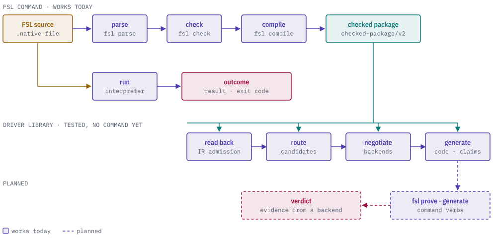

# filament-driver

[](https://discord.gg/k8DVhuYBR2)
[](https://github.com/agent-ix/filament-spec-language)

filament-driver is the `fsl` command-line tool and the Rust library behind it.
It runs a FSL specification from source to result.

It reads the source, has FSL check and package the rule, passes the checked
package to Contract IR and the code generators, and reports the result with one
exit code. It is the only component that calls both FSL and the code
generators.

<picture>
  <source media="(prefers-color-scheme: dark)" srcset="docs/images/hero-dark.svg">
  
</picture>

## Getting started

Download a prebuilt `fsl` binary from the [latest release](https://github.com/agent-ix/filament-driver/releases/latest)
(Linux x86_64 and aarch64, macOS arm64 and x86_64). Each release carries a
`SHA256SUMS.txt`. Or build from source: `rust-toolchain.toml` pins Rust 1.98.1,
which `rustup` installs on first use. Install the `fsl` binary using the
repository's locked dependencies:

```
cargo install --git https://github.com/agent-ix/filament-driver --locked fsl-cli
```

To install from a local checkout instead:

```
git clone https://github.com/agent-ix/filament-driver
cd filament-driver
cargo install --path fsl-cli --locked
```

Check the install with `fsl --version`.

## Commands

The binary is built from the `fsl-cli` package. Its verbs follow the FSL
command-line design:

| Verb | State | What it does |
| --- | --- | --- |
| `parse`, `check`, `compile`, `run` | works | Run the FSL stage of that name on one source file and print FSL's result document. Use `--format json`. |
| `format` | works | Print the source in FSL's canonical layout. |
| `analyze`, `monitor`, `prove`, `replay`, `generate`, `inspect`, `render` | planned | Recognized, and end as `unsupported` (exit 21) until a handler is written. |

`parse` and `format` take two logical source labels followed by the file path:

```sh
fsl parse example.org requirements source.fsl --format json
fsl format example.org requirements source.fsl
```

The labels identify the source; the file path is its physical location.

`run` accepts `--engine interpreter|aot|jit` and `--limit` overrides. The
interpreter is the linked engine, and the other engines are refused before
anything runs. The command supplies an empty object environment.

Every command ends with FSL's own exit code, passed through unchanged:

| Exit code | Meaning |
| --- | --- |
| 0 | success |
| 10 | violation or undefined |
| 20 | refused |
| 21 | unsupported |
| 22 | incomplete or inconclusive |
| 30 | internal failure |

### Example

This source defines one function that always returns true:

```
language "ix:native" edition "1-draft";
profile v = "filament.value.complete/v1";
function yes using v(): Boolean pure { true }
```

Save it as `yes.fsl`, then save this request as `yes.json`. Source labels are
logical names independent of the physical file path:

```json
{"format":"native-run/1","request":{"models":[],"program":{"source":{"file":"yes.fsl","authority":"example","identity":"yes","document":"ExampleYes","formal_revision":1}},"call":{"function":"yes","arguments":[]}}}
```

Run the request; the command exits with code 0:

```
fsl run yes.json --format json
```

`fsl compile` likewise takes a `native-compile/1` request file. Run intake
accepts `--request-bytes` and `--dependent-bytes`; compile uses fixed ceilings.

## Library

The `filament-driver` library crate exposes `drive`, which runs one request
through the stages below. FSL owns the language and the generators own code
generation, and the driver is the one place that joins them.

1. Parse, select, check and package the source with FSL, sharing one `Cancel`
   handle. The result is the `checked-package/v2` bytes and their identity.
2. Read those bytes back through Contract IR's reader. The package it admits
   carries the identity FSL just emitted.
3. Write the items to negotiate from the package's own checked requirement
   records, one per record. A unit with no scalar operation application has no
   records, so nothing is routed and nothing is generated.
4. Convert every registered backend to the code generator's backend kind. An
   id with no kind refuses the run before any negotiation, naming each one.
5. Negotiate with the backend providers, then route the items settled as
   supported.
6. Ask the code generator to generate for each routed item and return its
   settlements, claim map and generated artifacts.

The registry of backends is a value the caller builds from provider manifests
and passes in.

`execute` is the smaller entry point behind `fsl run`: it compiles one
source and calls one function on the selected engine, returning FSL's typed
outcome unchanged.

## Crates

| Crate | Role |
| --- | --- |
| `filament-driver` (root) | The library: `drive`, `execute`, the registry, limits and the cache interface. Depends on FSL and the code generator. |
| `fsl-cli` | The `fsl` binary: argument parsing and the command handlers. Depends on the driver and the cache. |
| `filament-plugin-host` | The process boundary for out-of-process backend providers: framing, wire types and lifecycle for the `filament.plugin-wire/v1` protocol. |
| `filament-cache` | A content-addressed on-disk cache that implements the driver's cache interface. |

The driver defines the cache interface and the cache implements it, so the
library never depends on its own cache.

## Filament ecosystem

<picture>
  <source media="(prefers-color-scheme: dark)" srcset="docs/images/ecosystem-dark.svg">
  
</picture>

filament-driver sits above the main chain and runs it. It
depends on the FSL layer crates from
[filament-spec-language](https://github.com/agent-ix/filament-spec-language),
on [filament-contract-codegen](https://github.com/agent-ix/filament-contract-codegen),
on the model crate of
[filament-contract-ir](https://github.com/agent-ix/filament-contract-ir), and on
[quire-canonical](https://github.com/agent-ix/quire-canonical) and
[filament-exact](https://github.com/agent-ix/filament-exact). No FSL, IR or
code-generator crate depends on it. It also uses `ix-cli-kit` for the
command-line exit and stream conventions.

## Building and testing

```
make fmt-check   # formatting
make lint        # clippy, warnings are errors
make test        # cargo test
make deny        # license and source policy
make spec        # quire validate over spec/
make ci          # every gate above plus doc checks
```

`make build` makes a release build. Requirements live in
[`spec/`](spec/spec.md).

## Contributing

Contributions are welcome under the contributor license agreement. See
[CONTRIBUTING.md](CONTRIBUTING.md) and [CLA.md](CLA.md).

## License

AGPL-3.0-or-later. See [LICENSE](LICENSE).
